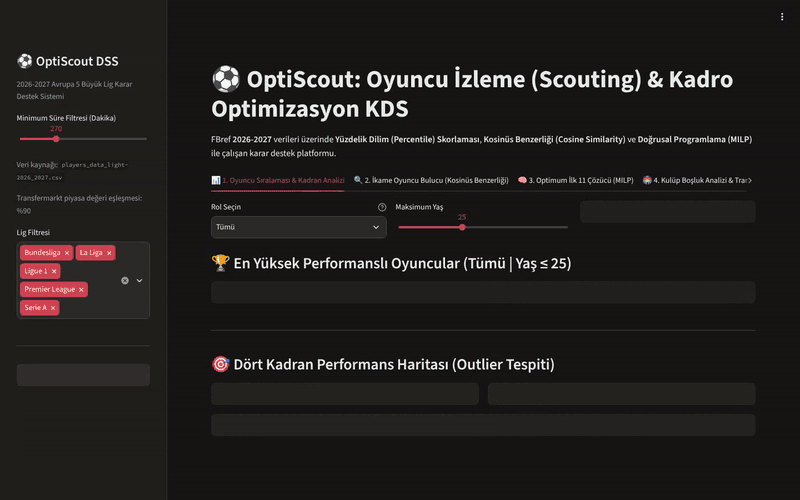
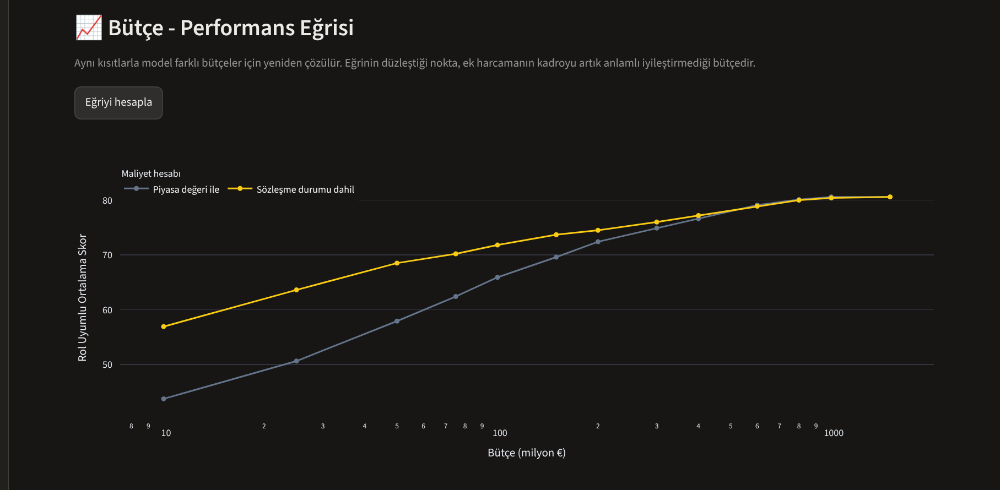
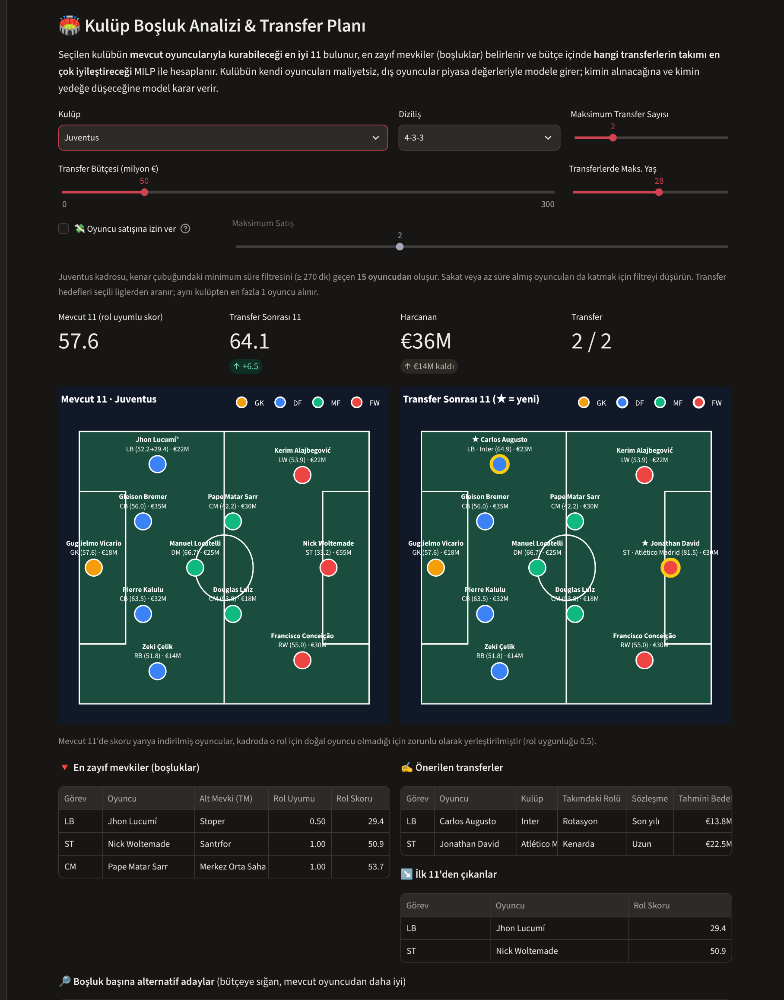
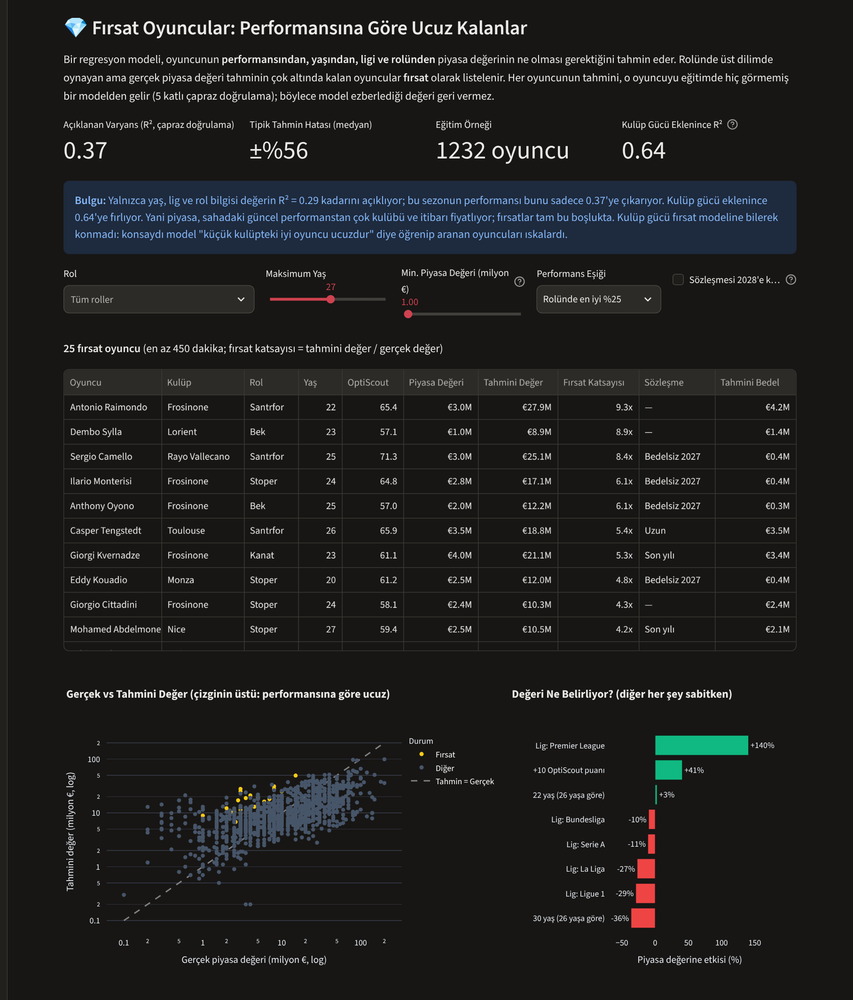

[](https://optiscout-turkensar.streamlit.app)
[](https://github.com/turkensar/optiscout-football-dss/actions/workflows/tests.yml)

# ⚽ OptiScout: Data-Driven Football Scouting & Squad Optimization DSS

Avrupa'nın 5 büyük ligindeki (Premier League, La Liga, Serie A, Bundesliga, Ligue 1) **2026-2027 sezonu FBref** verileri üzerine inşa edilmiş; **Veri Mühendisliği**, **İstatistiksel Benzerlik Analizi (Cosine Similarity)**, **Makine Öğrenmesi (piyasa değeri regresyonu)** ve **Yöneylem Araştırması (Mixed-Integer Linear Programming - MILP)** yöntemlerini birleştiren interaktif bir **Karar Destek Sistemi (Decision Support System - DSS)**.



---

## 🎯 Projenin Amacı ve Çözülen Problemler

Modern futbol analitiğinde oyuncu izleme (scouting) ve kadro planlama süreçleri üç temel analitik probleme dayanır:
1. **Adil Performans Kıyaslaması:** Farklı süreler alan ve farklı rollerde (stoper, bek, ön libero, kanat, santrfor...) görev yapan oyuncuların 90 dakika başına (`Per 90`) normalize edilerek kendi rolleri içinde yüzdelik dilimlerle (`Percentile 0-100`) puanlanması.
2. **İkame & Fırsat Oyuncu Keşfi (Player Similarity):** Takımdan ayrılan veya yüksek maliyetli bir yıldız oyuncunun oyun profiline istatistiksel olarak en çok benzeyen genç yeteneklerin (U23 Wonderkid) çok boyutlu uzayda bulunması.
3. **Kısıtlı Kadro Optimizasyonu (Squad Building):** Taktik diziliş, **transfer bütçesi**, yaş ortalaması sınırı ve kulüp başına maksimum oyuncu kısıtları altında matematiksel olarak en yüksek verimi üreten İlk 11'in kurulması; bütçe arttıkça kadronun ne kadar iyileştiğinin (azalan getiri) ölçülmesi.
4. **Kulüp Boşluk Analizi & Transfer Planı:** Belirli bir kulübün mevcut kadrosundaki en zayıf mevkilerin bulunması ve sınırlı bütçe ile transfer sayısı altında takımı en çok iyileştirecek transferlerin seçilmesi.
5. **Fırsat Oyuncu Tespiti:** Performansına göre piyasa değeri düşük kalan, yani piyasanın henüz fiyatlamadığı oyuncuların bulunması.

---

## 🏗️ Sistem Mimarisi ve Metodoloji

| Modül | Dosya | Kullanılan Yöntem & Algoritma | Açıklama |
| :--- | :--- | :--- | :--- |
| **1. Veri Mühendisliği & Skorlama** | `data_processor.py` | Per-90 Normalizasyon & Rol Bazlı Yüzdelik Dilim (`Percentile Rank`) | Ham FBref verilerini temizler, oyuncuları Transfermarkt alt mevkilerine göre rol gruplarına ayırır, savunma metriklerini topa sahip olmaya göre düzeltir, oyuncunun takıma etkisini (sahadayken gol farkı) ölçer, az dakika alan oyuncuların şişmiş oranlarını **Bayesian shrinkage** ile rol ortalamasına çeker ve Hücum, Yaratıcılık, Savunma, Disiplin alt kırılımlarıyla `0-100` arası **OptiScout_Score** üretir. |
| **2. İkame Oyuncu Motoru** | `similarity_engine.py` | `StandardScaler` (Z-Score) + `Cosine Similarity` (`scikit-learn`) | Oyuncuların rol bazlı Per-90 vektörlerini standartlaştırır ve seçilen referans oyuncuya en yüksek kosinüs benzerliği gösteren alternatifleri listeler. Model eğitimi gerektirmeyen, açıklanabilir bir mesafe ölçüsüdür. |
| **3. Optimum İlk 11 Çözücü** | `squad_optimizer.py` | Karışık Tamsayılı Doğrusal Programlama (`scipy.optimize.milp` - HiGHS Solver) | Seçilen formasyon (`4-3-3`, `4-2-3-1`, `3-5-2` vb.), **transfer bütçesi**, maksimum yaş ortalaması ve kulüp sınırı kısıtları altında toplam kadro skorunu maksimize eder; bütçe-performans eğrisini çizer ve **kulüp bazlı transfer planı** üretir. Formasyonlar Transfermarkt alt mevkilerine dayalı **taktik rollerle** (LB, CB, DM, AM, RW, ST...) tanımlanır. |
| **4. Piyasa Değeri Modeli** | `value_model.py` | Ridge regresyon, 5 katlı çapraz doğrulama (out-of-fold tahmin) | Performans, yaş, lig ve rolden beklenen piyasa değerini tahmin eder; gerçek değeri tahminin çok altında kalan üst dilim oyuncuları fırsat olarak listeler. |
| **5. Piyasa Değeri Eşleştirme** | `scripts/build_market_values.py` | İsim normalizasyonu + doğum yılı + kulüp benzerliği ile kademeli eşleştirme | FBref oyuncularını Transfermarkt piyasa değerleri, alt mevkileri ve sözleşme bitiş tarihleriyle eşleştirir ve `data/market_values.csv` dosyasını üretir. |
| **6. İnteraktif KDS Arayüzü** | `app.py` | `Streamlit` & `Plotly` | Rol bazlı oyuncu sıralaması, dört kadranlı aykırı değer (outlier) haritası, radar karşılaştırması, taktik tahtası ve bütçe-performans eğrisi sunar. |

---

## 📸 Uygulama Ekran Görüntüleri

### 1. Rol Bazlı Oyuncu Sıralaması
Skorlar rol içinde hesaplanır: kanatlar kanatlarla, bekler beklerle kıyaslanır.


### 2. Dört Kadran Performans Haritası (Outlier Tespiti)


### 3. Kosinüs Benzerliği ile İkame Oyuncu & Wonderkid Keşfi


### 4. Bütçe Kısıtlı Optimum İlk 11 (MILP) ve Taktik Tahtası


### 5. Bütçe - Performans Eğrisi
Model farklı bütçeler için yeniden çözülür; eğrinin düzleştiği nokta ek harcamanın artık anlamlı getiri sağlamadığı bütçedir.


### 6. Kulüp Boşluk Analizi & Transfer Planı
Juventus örneği: kadroda doğal sol bek olmadığı için bir stoper sol bekte oynar; model bütçe içinde sol bek ve santrfor transferi önerir (★ = yeni transfer).


### 7. Fırsat Oyuncular (Piyasa Değeri Modeli)
Çizginin üstündeki sarı noktalar, rolünde üst %25'te oynayıp piyasa değeri performansına göre tahminin çok altında kalan oyunculardır.


---

## 🧮 Matematiksel Optimizasyon Modeli (MILP)

Kadro optimizasyon modülü, $N$ oyuncudan oluşan havuzda her oyuncu $i$ ve oynayabileceği her taktik rol $r \in E_i$ için ikili karar değişkeni $x_{i,r} \in \{0, 1\}$ tanımlayarak aşağıdaki modeli çözer:

$$\max \sum_{i=1}^{N} \sum_{r \in E_i} \left( \text{Score}_i \cdot \alpha_{i,r} \right) x_{i,r}$$

Burada $\alpha_{i,r}$ **rol uygunluk katsayısıdır**. Oyuncunun Transfermarkt alt mevkisinden gelir: doğal rolünde 1.0, yakın rollerde 0.80–0.95 arası (ör. sol bek sol kanat bekinde 1.0, sağ bekte 0.85; 10 numara kanatta 0.85). Alt mevkisi bilinmeyen oyuncular FBref ana mevkisine göre 0.9 katsayıyla değerlendirilir.

| Formasyon | Roller |
| :--- | :--- |
| `4-3-3` | GK · LB · CB×2 · RB · DM · CM×2 · LW · RW · ST |
| `4-2-3-1` | GK · LB · CB×2 · RB · DM×2 · AM · LW · RW · ST |
| `4-4-2` | GK · LB · CB×2 · RB · CM×2 · LM · RM · ST×2 |
| `3-5-2` | GK · CB×3 · LWB · RWB · DM · CM×2 · ST×2 |
| `3-4-3` | GK · CB×3 · LWB · RWB · CM×2 · LW · RW · ST |

**Kısıtlar (Constraints):**
* **Formasyon Rol Kısıtı:** Her rol $r$ için $\sum_{i} x_{i,r} = R_r$ (toplamda 11 oyuncuyu da garanti eder)
* **Kişi Başına Tek Seçim:** Aynı oyuncu (birden fazla rol değişkeni veya sezon içi transfer nedeniyle iki kulüp satırı olsa bile) en fazla bir kez seçilir: $\sum_{i \in \text{kişi}_j} \sum_{r} x_{i,r} \le 1$
* **Kulüp Kotası Kısıtı:** Her kulüp $c$ için $\sum_{i \in C_c} \sum_{r} x_{i,r} \le K_{\max}$
* **Maksimum Yaş Ortalaması Kısıtı:** $\sum_{i,r} \text{Age}_i \cdot x_{i,r} \le 11 \cdot \text{Age}_{\max}$
* **Bütçe Kısıtı:** $\sum_{i,r} \text{Value}_i \cdot x_{i,r} \le B$ (Value: Transfermarkt piyasa değeri, € cinsinden)

Bütçe kısıtı açıkken piyasa değeri bilinmeyen oyuncular havuzdan çıkarılır; aksi halde model maliyeti bilinmeyen oyuncuları "bedava" sanıp kadroya doldururdu.

---

## 💶 Bütçe Kısıtlı Kadro ve Bütçe-Performans Eğrisi

Karar vericinin asıl sorusu "en iyi 11 kim?" değil, **"bu bütçeyle kurabileceğim en iyi 11 kim?"** sorusudur. Model, aynı kısıtlarla farklı bütçe seviyeleri için tekrar çözülerek bir **bütçe-performans eğrisi** üretir. Örnek sonuçlar (4-3-3, kulüp başına en fazla 2, yaş ortalaması ≤ 26,5, yalnızca bu sezonun formu, maliyet = piyasa değeri):

| Bütçe | Rol Uyumlu Ortalama Skor | Harcanan |
| :--- | :--- | :--- |
| €25M | 66.2 | €25M |
| €50M | 70.6 | €49M |
| €100M | 73.9 | €94M |
| €200M | 76.3 | €179M |
| €400M | 77.8 | €366M |
| Sınırsız | 77.9 | €516M |

İlk €100M kadroyu ~8 puan iyileştirirken (€25M → €100M), sonraki €300M yalnızca ~4 puan ekler ve €400M'dan sonra eğri tamamen düzleşir. Bu noktadan sonra her ek puan çok daha pahalıdır. Bu tür bir "azalan getiri" analizi, transfer bütçesinin nereye kadar anlamlı olduğunu gösterir.

### Piyasa değeri verisi

Değerler, Transfermarkt verisinden derlenen açık lisanslı (CC0) [transfermarkt-datasets](https://github.com/dcaribou/transfermarkt-datasets) projesinin `players` tablosundan alınır. Eşleştirmeyi yeniden üretmek için:

```bash
# players.csv(.gz) dosyasını data/ klasörüne indirin, ardından:
python scripts/build_market_values.py --tm data/players.csv.gz
```

FBref oyuncularının yaklaşık %90'ı eşleşir (Premier League %94, Ligue 1 %84). Eşleştirme kademelidir: tam isim → kelime kümesi → soyad + ilk ad öneki → bulanık benzerlik. Her adımda doğum yılı aynı olmalıdır. Belirsiz kalan eşleşmeler bilerek boş bırakılır.

---

## 🏟️ Kulüp Boşluk Analizi & Transfer Planı

"En iyi 11 kim?" sorusu bir kulüp için gerçekçi değildir; asıl soru **"Elimdeki kadroya, bu bütçeyle kimi eklersem takım en çok iyileşir?"** sorusudur. Bu modül üç adımda çalışır:

1. **Mevcut 11:** Kulübün kendi oyuncularıyla kurulabilecek en iyi 11 MILP ile bulunur. Kadroda bir rol için doğal oyuncu yoksa (ör. sol bek), bir saha oyuncusu o role **0.5 uygunluk katsayısıyla** zorunlu olarak yerleştirilir; bu, boşluğu skora yansıtır.
2. **Boşluklar:** Mevcut 11'de rol uyumlu skoru en düşük mevkiler listelenir.
3. **Transfer planı:** Kulübün kendi oyuncuları (maliyet 0) ve dış oyuncular (maliyet = piyasa değeri) aynı modele girer. Mevcut kısıtlara iki kısıt eklenir:

$$\sum_{i \in \text{Dış}} \sum_{r} \text{Value}_i \cdot x_{i,r} \le B \qquad \sum_{i \in \text{Dış}} \sum_{r} x_{i,r} \le N_{\text{transfer}}$$

Kimin alınacağına **ve kimin yedeğe düşeceğine** model kendisi karar verir; örneğin yeni bir bek alınınca, daha önce o rolde zorunlu oynayan stoper kendi mevkisine döner. Ayrıca her boşluk için, bütçeye sığan ve mevcut oyuncudan daha iyi olan alternatif adaylar listelenir; böylece karar verici tek bir "optimum" öneriyle sınırlı kalmaz.

**Oyuncu satışı (isteğe bağlı):** Kulübün her oyuncusu için ek bir ikili değişken $s_i$ ("satılsın mı?") tanımlanır. Satılan oyuncu sahada olamaz ve satış geliri bütçeye eklenir:

$$\sum_{i \in \text{Dış}} \sum_{r} \text{Bedel}_i \cdot x_{i,r} \;\le\; B + \sum_{i \in \text{Kulüp}} \text{Gelir}_i \cdot s_i \qquad \sum_{r} x_{i,r} + s_i \le 1 \qquad \sum_i s_i \le N_{\text{satış}}$$

Satış geliri de gerçekçi bedelle hesaplanır (sözleşmesi biten oyuncu az, kilit oyuncu primli getirir) ve hedef fonksiyondaki çok küçük bir ceza sayesinde bir oyuncu yalnızca satışı daha iyi bir transferi finanse ediyorsa satılır.

**Kilit oyuncular ve insan kararı:** Takım dakikalarının ≥ %65'ini oynayan **kilit oyuncular varsayılan olarak satışa kapalıdır**; bir kulüp formdaki kilit oyuncusunu yalnızca sayısal bir iyileşme için satmaz. Kullanıcı "satışa kapalı oyuncular" listesine istediği oyuncuyu ekleyip çıkarabilir: model öneri yapar, karar karar vericinindir. Örneğin sıfır bütçeli bir senaryoda Real Madrid, kilit oyuncularına dokunmadan rotasyon ve kenar oyuncularını (Dumfries, Rüdiger) satıp gelirle bir stoper, bir sol bek ve bir orta saha alır; rol uyumlu skor 63,3'ten 68,5'e çıkar.

**Örnek (Juventus, 4-3-3, €30M, en fazla 1 transfer, yalnızca form):** Kadroda doğal sol bek olmadığı için bir stoper (Lucumí) sol bekte oynar ve rol uyumlu skoru 26,1'e düşer. Model €7M'luk bir sol bek önerir ve takımın rol uyumlu ortalaması 52,0'den 56,4'e çıkar. Bütçe €50M ve 2 transfere çıkınca bir santrfor da eklenir.

---

## 📝 Sözleşme Durumu ve Tahmini Transfer Bedeli

Piyasa değeri, bir oyuncunun gerçekte kaça alınabileceğini her zaman göstermez. Sözleşmesi bitmek üzere olan bir oyuncuyu kulübü bedelsiz kaybetmemek için ucuza satar; sözleşmesi bitmiş oyuncu ise bedelsiz gelir. OptiScout, Transfermarkt'taki sözleşme bitiş tarihini kullanarak bir sonraki yaz transfer dönemi (1 Temmuz 2027) için **tahmini transfer bedeli** hesaplar:

| Sözleşme durumu (Temmuz 2027) | Tahmini bedel |
| :--- | :--- |
| Bitmiş (bedelsiz) | Piyasa değerinin %15'i (imza ücreti, menajer payı gibi masraflar) |
| Son yılında (2028'de bitiyor) | Piyasa değerinin %60'ı |
| Daha uzun / bilinmiyor | Piyasa değerinin tamamı |

Bedel ayrıca oyuncunun **takımındaki rolüne** göre ayarlanır, çünkü bir kulüp formdaki kilit oyuncusunu piyasa değerine bırakmaz:

| Takımdaki rol (takım dakikalarından aldığı pay) | Çarpan |
| :--- | :---: |
| Kilit oyuncu (≥ %65) | ×1.40 |
| Rotasyon (%40–65) | ×1.00 |
| Kenarda (< %40) | ×0.75 |

Sözleşmesi biten oyuncuya rol primi uygulanmaz (kulübün pazarlık gücü yoktur).

Kenar çubuğundaki "Gerçekçi transfer bedeli" seçeneğiyle açılıp kapatılabilir; açıkken bütçe kısıtı, transfer planı, satış gelirleri ve fırsat listesi bu tahmini bedeli kullanır.

**Etkisi en çok küçük bütçelerde görülür** (4-3-3, kulüp başına en fazla 2, yaş ortalaması ≤ 26,5, yalnızca form):

| Bütçe | Yalnızca piyasa değeri | Sözleşme durumu dahil |
| :--- | :---: | :---: |
| €10M | 60.9 | **67.1** |
| €25M | 66.2 | **70.1** |
| €50M | 70.6 | **72.9** |
| €100M | 73.9 | 74.6 |
| €200M | 76.3 | 76.3 |

Sözleşmesi biten oyuncuları takip etmek, küçük bütçeli bir kulübün aynı parayla belirgin şekilde daha iyi bir kadro kurmasını sağlar; büyük bütçede fark kapanır. Örneğin fırsat listesindeki Sergio Camello'nun (Rayo Vallecano, €3M) sözleşmesi Haziran 2027'de bitmektedir.

---

## 💎 Fırsat Oyuncular: Piyasa Değeri Modeli

Bir **Ridge regresyon** modeli, oyuncunun bu sezonki performansından (OptiScout ve alt skorlar), yaşından, dakikasından, ilk 11 oranından, liginden ve rolünden **log(piyasa değeri)** tahmin eder. Rolünde üst dilimde oynayan ama gerçek değeri tahminin çok altında kalan oyuncular **fırsat** olarak listelenir (fırsat katsayısı = tahmini değer / gerçek değer).

**Tasarım kararları:**
* **Out-of-fold tahmin:** Her oyuncunun tahmini, o oyuncuyu eğitimde görmemiş bir modelden gelir (5 katlı çapraz doğrulama). Tüm veriyle eğitilen bir model ezberlediği değeri geri verir ve fırsat sinyali kaybolur.
* **Kulüp gücü bilerek modele konmadı:** Takım arkadaşlarının ortalama değeri (oyuncunun kendisi hariç) eklendiğinde açıklanan varyans ~2 katına çıkar; ama model "küçük kulüpteki iyi oyuncu ucuzdur" diye öğrenir ve tam da aranan gizli cevherleri ıskalar.
* **Model seçimi:** Gradient boosting (HistGradientBoosting) bu veri boyutunda Ridge'i geçemedi; Ridge hem daha iyi genelleşti hem de katsayıları yorumlanabilir.

**Sonuçlar (5 katlı çapraz doğrulama, 1.232 oyuncu):**

| Model | Açıklanan varyans (R²) |
| :--- | :---: |
| Yalnızca yaş + lig + rol | 0.29 |
| + bu sezonun performansı (**fırsat modeli**) | 0.37 |
| + kulüp gücü (karşılaştırma) | 0.64 |

Fırsat modelinin tipik (medyan) tahmin hatası ±%56'dır. **Bulgu:** Bu sezonun performansı piyasa değerinin küçük bir kısmını açıklar; değeri asıl belirleyen kulüp, lig ve itibardır. Örneğin aynı performans ve yaştaki bir oyuncu Premier League'de ortalama lige göre ~2,4 kat değerlidir, 30 yaşındaki bir oyuncu 26 yaşındakinden ~%36 ucuzdur. Piyasanın güncel performansı yeterince fiyatlamaması, fırsat tespitinin dayandığı boşluktur (*Moneyball* yaklaşımı).

Bu nedenle liste bir **karar değil, ön elemedir**: sakatlık geçmişi, sözleşme süresi, potansiyel ve sezonun ilk haftalarındaki şans faktörü modelde yoktur.

---

## 🎯 Rol Bazlı Skorlama

FBref yalnızca dört geniş mevki verir (`GK`, `DF`, `MF`, `FW`). Bu kaba ayrımda bir bek stoperlerle, bir kanat oyuncusu merkez orta sahalarla kıyaslanır. Veride FBref'in `MF` dediği 125'ten fazla kanat ve 60'tan fazla bek vardır. OptiScout, Transfermarkt alt mevkisini kullanarak her oyuncuyu bir **rol grubu** içinde puanlar ve her role ayrı ağırlıklar uygular:

| Rol | Savunma | Takıma Etki | Yaratıcılık | Hücum | Disiplin |
| :--- | :---: | :---: | :---: | :---: | :---: |
| Kaleci (GK) | — (kalecilik 0.70) | 0.25 | — | — | 0.05 |
| Stoper (CB) | 0.40 | 0.30 | 0.05 | 0.10 | 0.15 |
| Bek (FB) | 0.30 | 0.20 | 0.30 | 0.05 | 0.15 |
| Ön Libero (DM) | 0.35 | 0.25 | 0.20 | 0.05 | 0.15 |
| Merkez Orta Saha (CM) | 0.25 | 0.20 | 0.30 | 0.20 | 0.05 |
| 10 Numara (AM) | — | 0.20 | 0.35 | 0.40 | 0.05 |
| Kanat (W) | — | 0.20 | 0.30 | 0.45 | 0.05 |
| Santrfor (ST) | — | 0.20 | 0.10 | 0.65 | 0.05 |

**Alt skorlar:** Hücum = penaltısız gol+asist (%40), gol (%25), isabetli şut (%20), şut başına gol (%15). Yaratıcılık = asist (%60), faul yaptırma (%25), orta (%15). Bekler için ortaların ağırlığı %30'dur, çünkü orta yalnızca bekler için anlamlı bir yaratıcılık göstergesidir; aksi halde çok orta yapan bir kanat oyuncusu, içe kat eden bir dribling oyuncusunu geride bırakır. Savunma = top kapma + araya girme.

**Takıma Etki:** Oyuncu sahadayken takımın sonuçlarından hesaplanır: 90 dakikada gol farkı (%40), sahadayken yenen gol (%35, az olan iyi) ve sahadayken/sahada değilken takımın performans farkı (On-Off, %25). Top kapma ve araya girme sayısı bir stoperin değerini tek başına yakalayamaz; takımın o oyuncu sahadayken gol yememesi çok daha güçlü bir sinyaldir. On-Off çok gürültülü olduğu için sıfıra doğru güçlü şekilde çekilir.

**Topa sahip olma düzeltmesi (PAdj):** Topu çok elinde tutan takımların (Arsenal, PSG, Manchester City) oyuncuları daha az savunma yapmak zorunda kalır ve ham top kapma/araya girme sayıları onları haksız yere düşük gösterir. Veride topa sahip olma oranı olmadığından, takımın 90 dakikada yaptığı toplam savunma aksiyonu vekil olarak kullanılır: her oyuncunun savunma aksiyonları `lig ortalaması / takım değeri` katsayısıyla (0.7–1.4 arası) ölçeklenir. Örneğin Arsenal ~1.27, Crystal Palace ~0.75 katsayı alır.

**Yüzdelik dilim + z-skor:** Her metrik puanı, yüzdelik dilim ile ölçeklenmiş z-skorun yarı yarıya karışımıdır. Yalnızca yüzdelik dilim kullanılsaydı 15 gol ile 4 gol aynı "%99'luk dilim" sayılır ve fark kaybolurdu. z-skor ise oyuncunun ortalamadan ne kadar uzak olduğunu korur (aşırı uç değerlerin etkisini sınırlamak için ±3 standart sapmada kesilir). Bu yüzden skorlar 0–100 aralığının tamamını kullanmaz; rol içindeki en iyi oyuncular genellikle 75–85 aralığındadır.

Kaleciler kurtarış yüzdesi, gol yemeden biten maç oranı, 90 dakikada yenen gol ve kurtarış sayısıyla puanlanır. Alt mevkisi bilinmeyen oyuncular ile 20'den az oyuncu içeren rol grupları (ör. dakika filtresi çok yüksek seçildiğinde) FBref'in geniş mevki grubu içinde puanlanır; `Score_Group` sütunu her oyuncunun hangi grupta puanlandığını gösterir. Benzerlik motoru da aynı rol gruplarını kullanır, böylece bir kanat oyuncusunun alternatifleri FBref etiketinden bağımsız olarak diğer kanatlar arasından aranır.

---

## ⚖️ Güncel Form mu, Kalıcı Kalite mi? (Karar Skoru)

Bu sezonun ilk 10 maçı gürültülüdür: elit bir stoper birkaç kötü maçla sıralamada geride görünebilir. Her şey yalnızca veri değildir; piyasa değeri ise oyuncunun yıllara yayılan performansını ve itibarını yansıtır. Kadro ve transfer kararlarında kullanılan **karar skoru** iki kaynağı karıştırır:

$$\text{Karar Skoru} = w \cdot \text{OptiScout (form)} + (1 - w) \cdot \text{Kalıcı Kalite}$$

Kalıcı kalite, oyuncunun piyasa değerinin kendi rolü içindeki yüzdelik sırasıdır. Ağırlık $w$ kenar çubuğundan seçilir (varsayılan %70): %100 yalnızca bu sezonun verisine güvenir, daha düşük değerler sezon başı gürültüsüne karşı oyuncunun itibarını da hesaba katar. Oyuncu sıralaması ve fırsat modeli yalnızca formu kullanır; karar skoru kadro ve transfer kararlarında devreye girer.

---

## 📉 Küçük Örneklem Düzeltmesi (Bayesian Shrinkage)

Sezonun başında 300 dakika oynamış bir oyuncunun 3 golü, 90 dakika başına çok yüksek bir orana dönüşür. Bu gürültüyü azaltmak için skorlama ve benzerlik hesaplarında her oran, oyuncunun rol grubunun ortalamasına doğru çekilir (ör. bir kanat oyuncusu, FBref onu `MF` ya da `FW` olarak etiketlemiş olsun, kanat ortalamasına çekilir):

$$\text{oran}_{adj} = \frac{\text{sayı} + \mu_{\text{rol}} \cdot k}{\text{payda} + k}$$

Per-90 metriklerde $k = 450$ dakikadır (5 maçlık sanal veri). Çok oynayan oyuncular neredeyse hiç etkilenmez. Tablolarda gösterilen `*_p90` değerleri ham değerlerdir.

---

## ⚠️ Bilinen Sınırlamalar

* **xG/xA yok:** FBref artık gelişmiş Opta metriklerini yayınlamadığı için skorlar gol, asist ve şut gibi temel istatistiklere dayanır.
* **Bedel ve etki varsayımları:** Takıma etki metrikleri takımın genel gücünden de etkilenir (iyi takımda oynayan oyuncunun gol farkı yüksektir); bu yüzden takımın gücünden bağımsız olan On-Off da kullanılır. Topa sahip olma düzeltmesi gerçek topa sahip olma oranı yerine bir vekil kullanır. Kilit oyuncu eşiği (%65) ve rol çarpanları (×1.4 / ×0.75) varsayımdır. %15 ve %60 oranları sektör pratiğine dayalı varsayımlardır; sözleşme tarihleri Temmuz 2026 tarihlidir ve sonrasında yapılan uzatmaları içermez. Veriden önce bitmiş görünen sözleşmeler eskimiş kayıt sayılır ve tam bedel uygulanır.
* **Değer modeli:** Bu sezonun ilk haftalarındaki performansa dayanır ve piyasa değerindeki değişimin yalnızca üçte birini açıklar (R² ≈ 0.37); fırsat listesi bir ön eleme aracıdır.
* **Transfer planı varsayımları:** Maaşlar modele dahil değildir. Satış kararlarında model yalnızca ilk 11'in gücüne bakar; kadro derinliğini ve oyuncunun varlık değerini hesaba katmaz (ör. ilk 11'i çok az iyileştirmek için değerli bir oyuncuyu satabilir), bu yüzden satış sayısı sınırlı tutulmalıdır. Maliyet olarak piyasa değeri ya da sözleşme durumuna göre tahmini bedel kullanılır. Kulüp kadrosu yalnızca süre filtresini geçen oyunculardan oluşur; sakat veya az oynamış oyuncular için filtre düşürülmelidir.
* **Penaltısız, dakika başına üretim:** Skorlar toplam gol sayısını değil penaltısız 90 dakika başına üretimi ödüllendirir. Bu yüzden örneğin penaltı golleri olan ve çok oynayan bir yıldız, daha az oynayıp yüksek oranla gol atan bir oyuncunun gerisinde kalabilir.
* **Rol verisi:** Roller Transfermarkt'ın tek bir "ana" alt mevkisine dayanır; birden fazla rolde oynayan oyuncular yalnızca ana rolünde puanlanır (MILP'de diğer rollere uygunluk katsayısıyla yerleştirilebilir). Rol ağırlıkları uzman görüşüne dayalı varsayımlardır.
* **Takım ve lig bağlamı:** Savunma aksiyonları topa sahip olma oranından, kaleci metrikleri takım savunmasından etkilenir; ligler arası güç farkı henüz modelde yoktur.
* **Piyasa değeri tarihi:** Transfermarkt verisi 6 Temmuz 2026 tarihli bir anlık görüntüdür; yaz transfer dönemindeki değer değişimlerini içermez. Piyasa değeri bir tahmindir, gerçek bonservis bedeli değildir.
* **Oyuncu kimliği:** Veride benzersiz oyuncu ID'si yok; kimlik `isim + doğum yılı` ile kurulur. Aynı isim ve doğum yılına sahip iki farklı oyuncu (ör. iki "Vitinha") tek kişi sayılır. Yaşı ve doğum yılı boş olan oyuncular analizden çıkarılır.

---

## 🚀 Kurulum ve Çalıştırma

```bash
# 1. Repoyu klonlayın
git clone https://github.com/turkensar/optiscout-football-dss.git
cd optiscout-football-dss

# 2. Gerekli kütüphaneleri yükleyin
pip install -r requirements.txt

# 3. Streamlit karar destek arayüzünü başlatın
python -m streamlit run app.py
```

### Testler

```bash
pip install pytest
python -m pytest -q
```

