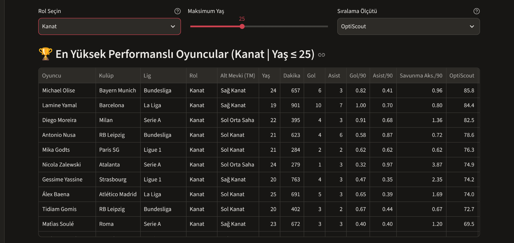
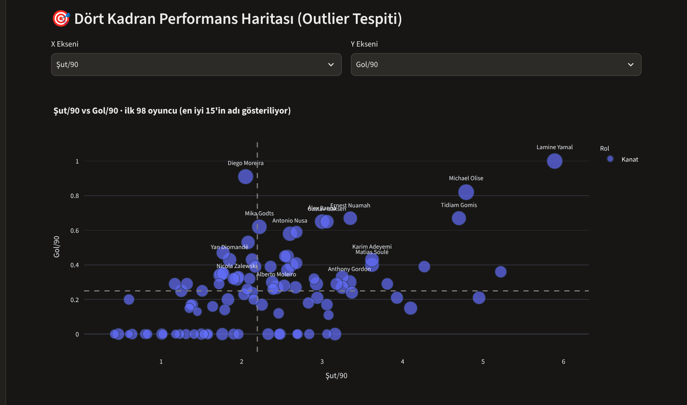
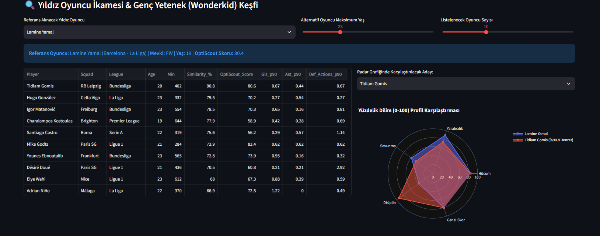
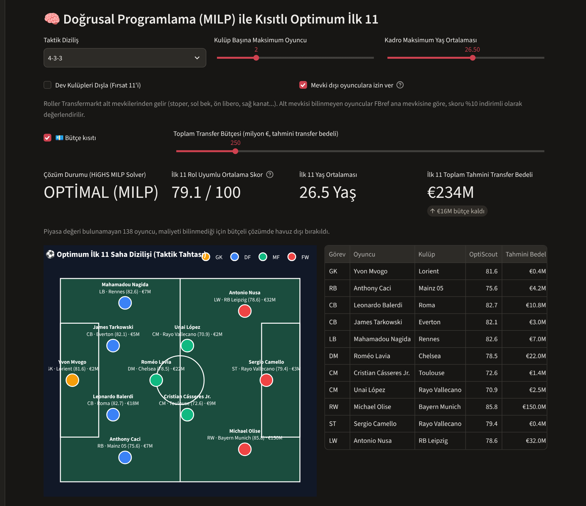

[](https://optiscout-turkensar.streamlit.app)

# ⚽ OptiScout: AI-Driven Football Scouting & Squad Optimization DSS

Avrupa'nın 5 büyük ligindeki (Premier League, La Liga, Serie A, Bundesliga, Ligue 1) **2026-2027 sezonu FBref** verileri üzerine inşa edilmiş; **Veri Mühendisliği**, **Makine Öğrenmesi (Cosine Similarity)** ve **Yöneylem Araştırması (Mixed-Integer Linear Programming - MILP)** yöntemlerini birleştiren interaktif bir **Karar Destek Sistemi (Decision Support System - DSS)**.

---

## 🎯 Projenin Amacı ve Çözülen Problemler

Modern futbol analitiğinde oyuncu izleme (scouting) ve kadro planlama süreçleri üç temel analitik probleme dayanır:
1. **Adil Performans Kıyaslaması:** Farklı süreler alan ve farklı rollerde (stoper, bek, ön libero, kanat, santrfor...) görev yapan oyuncuların 90 dakika başına (`Per 90`) normalize edilerek kendi rolleri içinde yüzdelik dilimlerle (`Percentile 0-100`) puanlanması.
2. **İkame & Fırsat Oyuncu Keşfi (Player Similarity):** Takımdan ayrılan veya yüksek maliyetli bir yıldız oyuncunun oyun profiline istatistiksel olarak en çok benzeyen genç yeteneklerin (U23 Wonderkid) çok boyutlu uzayda bulunması.
3. **Kısıtlı Kadro Optimizasyonu (Squad Building):** Taktik diziliş, yaş ortalaması sınırı ve kulüp başına maksimum oyuncu kısıtları altında matematiksel olarak en yüksek verimi üreten İlk 11'in kurulması.

---

## 🏗️ Sistem Mimarisi ve Metodoloji

| Modül | Dosya | Kullanılan Yöntem & Algoritma | Açıklama |
| :--- | :--- | :--- | :--- |
| **1. Veri Mühendisliği & Skorlama** | `data_processor.py` | Per-90 Normalizasyon & Rol Bazlı Yüzdelik Dilim (`Percentile Rank`) | Ham FBref verilerini temizler, oyuncuları Transfermarkt alt mevkilerine göre rol gruplarına ayırır, az dakika alan oyuncuların şişmiş oranlarını **Bayesian shrinkage** ile mevki ortalamasına çeker ve Hücum, Yaratıcılık, Savunma, Disiplin alt kırılımlarıyla `0-100` arası **OptiScout_Score** üretir. |
| **2. İkame Oyuncu Motoru** | `similarity_engine.py` | `StandardScaler` (Z-Score) + `Cosine Similarity` (`scikit-learn`) | Oyuncuların mevki bazlı Per-90 vektörlerini standartlaştırır ve seçilen referans oyuncuya en yüksek kosinüs benzerliği gösteren alternatifleri listeler. |
| **3. Optimum İlk 11 Çözücü** | `squad_optimizer.py` | Karışık Tamsayılı Doğrusal Programlama (`scipy.optimize.milp` - HiGHS Solver) | Seçilen formasyon (`4-3-3`, `4-2-3-1`, `3-5-2` vb.), **transfer bütçesi**, maksimum yaş ortalaması ve kulüp sınırı kısıtları altında toplam kadro skorunu maksimize eder; bütçe-performans eğrisini çizer. Formasyonlar Transfermarkt alt mevkilerine dayalı **taktik rollerle** (LB, CB, DM, AM, RW, ST...) tanımlanır. |
| **5. Piyasa Değeri Eşleştirme** | `scripts/build_market_values.py` | İsim normalizasyonu + doğum yılı + kulüp benzerliği ile kademeli eşleştirme | FBref oyuncularını Transfermarkt piyasa değerleriyle eşleştirir ve `data/market_values.csv` dosyasını üretir. |
| **4. İnteraktif KDS Arayüzü** | `app.py` | `Streamlit` & `Plotly` | Dört kadranlı aykırı değer (outlier) haritası, yüzdelik dilim radar karşılaştırması ve yeşil saha üzerinde taktik diziliş görselleştirmesi sunar. |

---

## 📸 Uygulama Ekran Görüntüleri

### 1. Oyuncu Sıralaması ve Performans Skorlaması


### 2. Dört Kadran Performans Haritası (Outlier Tespiti)


### 3. Makine Öğrenmesi ile İkame Oyuncu & Wonderkid Keşfi (Cosine Similarity)


### 4. Doğrusal Programlama (MILP) ile Kısıtlı Optimum İlk 11 ve Taktik Tahtası


---

## 🧮 Matematiksel Optimizasyon Modeli (MILP)

Kadro optimizasyon modülü, $N$ oyuncudan oluşan havuzda her oyuncu $i$ ve oynayabileceği her taktik rol $r \in E_i$ için ikili karar değişkeni $x_{i,r} \in \{0, 1\}$ tanımlayarak aşağıdaki modeli çözer:

$$\max \sum_{i=1}^{N} \sum_{r \in E_i} \left( \text{Score}_i \cdot \alpha_{i,r} \right) x_{i,r}$$

Burada $\alpha_{i,r}$ **rol uygunluk katsayısıdır**. Oyuncunun Transfermarkt alt mevkisinden gelir: doğal rolünde 1.0, yakın rollerde 0.80–0.95 arası (ör. sol bek sol kanat bekinde 1.0, sağ bekte 0.85; 10 numara kanatta 0.85). Alt mevkisi bilinmeyen oyuncular FBref ana mevkisine göre 0.9 katsayıyla değerlendirilir.

| Formasyon | Roller |
| :--- | :--- |
| `4-3-3` | GK · LB · CB×2 · RB · DM · CM×2 · LW · RW · ST |
| `4-2-3-1` | GK · LB · CB×2 · RB · DM×2 · AM · LW · RW · ST |
| `4-4-2` | GK · LB · CB×2 · RB · CM×2 · LM · RM · ST×2 |
| `3-5-2` | GK · CB×3 · LWB · RWB · DM · CM×2 · ST×2 |
| `3-4-3` | GK · CB×3 · LWB · RWB · CM×2 · LW · RW · ST |

**Kısıtlar (Constraints):**
* **Formasyon Rol Kısıtı:** Her rol $r$ için $\sum_{i} x_{i,r} = R_r$ (toplamda 11 oyuncuyu da garanti eder)
* **Kişi Başına Tek Seçim:** Aynı oyuncu (birden fazla rol değişkeni veya sezon içi transfer nedeniyle iki kulüp satırı olsa bile) en fazla bir kez seçilir: $\sum_{i \in \text{kişi}_j} \sum_{r} x_{i,r} \le 1$
* **Kulüp Kotası Kısıtı:** Her kulüp $c$ için $\sum_{i \in C_c} \sum_{r} x_{i,r} \le K_{\max}$
* **Maksimum Yaş Ortalaması Kısıtı:** $\sum_{i,r} \text{Age}_i \cdot x_{i,r} \le 11 \cdot \text{Age}_{\max}$
* **Bütçe Kısıtı:** $\sum_{i,r} \text{Value}_i \cdot x_{i,r} \le B$ (Value: Transfermarkt piyasa değeri, € cinsinden)

Bütçe kısıtı açıkken piyasa değeri bilinmeyen oyuncular havuzdan çıkarılır; aksi halde model maliyeti bilinmeyen oyuncuları "bedava" sanıp kadroya doldururdu.

---

## 💶 Bütçe Kısıtlı Kadro ve Bütçe-Performans Eğrisi

Karar vericinin asıl sorusu "en iyi 11 kim?" değil, **"bu bütçeyle kurabileceğim en iyi 11 kim?"** sorusudur. Model, aynı kısıtlarla farklı bütçe seviyeleri için tekrar çözülerek bir **bütçe-performans eğrisi** üretir. Varsayılan ayarlarla (4-3-3, kulüp başına en fazla 2, yaş ortalaması ≤ 26,5) örnek sonuçlar:

| Bütçe | Rol Uyumlu Ortalama Skor | Harcanan |
| :--- | :--- | :--- |
| €25M | 71.6 | €25M |
| €50M | 75.7 | €50M |
| €100M | 77.8 | €100M |
| €200M | 78.2 | €162M |
| €400M | 79.2 | €308M |
| Sınırsız | 79.2 | €308M |

İlk €100M kadroyu yaklaşık 6 puan iyileştirirken, sonraki €200M yalnızca ~1,5 puan ekler; €308M'ın üzerindeki bütçe hiç kullanılmaz. Bu noktadan sonra her ek puan çok daha pahalıdır. Bu tür bir "azalan getiri" analizi, transfer bütçesinin nereye kadar anlamlı olduğunu gösterir.

### Piyasa değeri verisi

Değerler, Transfermarkt verisinden derlenen açık lisanslı (CC0) [transfermarkt-datasets](https://github.com/dcaribou/transfermarkt-datasets) projesinin `players` tablosundan alınır. Eşleştirmeyi yeniden üretmek için:

```bash
# players.csv(.gz) dosyasını data/ klasörüne indirin, ardından:
python scripts/build_market_values.py --tm data/players.csv.gz
```

FBref oyuncularının yaklaşık %90'ı eşleşir (Premier League %94, Ligue 1 %84). Eşleştirme kademelidir: tam isim → kelime kümesi → soyad + ilk ad öneki → bulanık benzerlik. Her adımda doğum yılı aynı olmalıdır. Belirsiz kalan eşleşmeler bilerek boş bırakılır.

---

## 🎯 Rol Bazlı Skorlama

FBref yalnızca dört geniş mevki verir (`GK`, `DF`, `MF`, `FW`). Bu kaba ayrımda bir bek stoperlerle, bir kanat oyuncusu merkez orta sahalarla kıyaslanır. Veride FBref'in `MF` dediği 125'ten fazla kanat ve 60'tan fazla bek vardır. OptiScout, Transfermarkt alt mevkisini kullanarak her oyuncuyu bir **rol grubu** içinde puanlar ve her role ayrı ağırlıklar uygular:

| Rol | Savunma | Yaratıcılık | Hücum | Disiplin |
| :--- | :---: | :---: | :---: | :---: |
| Stoper (CB) | 0.65 | 0.10 | 0.10 | 0.15 |
| Bek (FB) | 0.45 | 0.35 | 0.05 | 0.15 |
| Ön Libero (DM) | 0.50 | 0.25 | 0.10 | 0.15 |
| Merkez Orta Saha (CM) | 0.30 | 0.35 | 0.25 | 0.10 |
| 10 Numara (AM) | 0.05 | 0.45 | 0.45 | 0.05 |
| Kanat (W) | 0.05 | 0.35 | 0.55 | 0.05 |
| Santrfor (ST) | 0.05 | 0.15 | 0.75 | 0.05 |

**Alt skorlar:** Hücum = penaltısız gol+asist (%40), gol (%25), isabetli şut (%20), şut başına gol (%15). Yaratıcılık = asist (%60), faul yaptırma (%25), orta (%15). Bekler için ortaların ağırlığı %30'dur, çünkü orta yalnızca bekler için anlamlı bir yaratıcılık göstergesidir; aksi halde çok orta yapan bir kanat oyuncusu, içe kat eden bir dribling oyuncusunu geride bırakır. Savunma = top kapma + araya girme.

**Yüzdelik dilim + z-skor:** Her metrik puanı, yüzdelik dilim ile ölçeklenmiş z-skorun yarı yarıya karışımıdır. Yalnızca yüzdelik dilim kullanılsaydı 15 gol ile 4 gol aynı "%99'luk dilim" sayılır ve fark kaybolurdu. z-skor ise oyuncunun ortalamadan ne kadar uzak olduğunu korur (aşırı uç değerlerin etkisini sınırlamak için ±3 standart sapmada kesilir). Bu yüzden skorlar 0–100 aralığının tamamını kullanmaz; rol içindeki en iyi oyuncular genellikle 75–85 aralığındadır.

Kaleciler kurtarış yüzdesi, gol yemeden biten maç oranı, 90 dakikada yenen gol ve kurtarış sayısıyla puanlanır. Alt mevkisi bilinmeyen oyuncular ile 20'den az oyuncu içeren rol grupları (ör. dakika filtresi çok yüksek seçildiğinde) FBref'in geniş mevki grubu içinde puanlanır; `Score_Group` sütunu her oyuncunun hangi grupta puanlandığını gösterir. Benzerlik motoru da aynı rol gruplarını kullanır, böylece bir kanat oyuncusunun alternatifleri FBref etiketinden bağımsız olarak diğer kanatlar arasından aranır.

---

## 📉 Küçük Örneklem Düzeltmesi (Bayesian Shrinkage)

Sezonun başında 300 dakika oynamış bir oyuncunun 3 golü, 90 dakika başına çok yüksek bir orana dönüşür. Bu gürültüyü azaltmak için skorlama ve benzerlik hesaplarında her oran, oyuncunun rol grubunun ortalamasına doğru çekilir (ör. bir kanat oyuncusu, FBref onu `MF` ya da `FW` olarak etiketlemiş olsun, kanat ortalamasına çekilir):

$$\text{oran}_{adj} = \frac{\text{sayı} + \mu_{\text{rol}} \cdot k}{\text{payda} + k}$$

Per-90 metriklerde $k = 450$ dakikadır (5 maçlık sanal veri). Çok oynayan oyuncular neredeyse hiç etkilenmez. Tablolarda gösterilen `*_p90` değerleri ham değerlerdir.

---

## ⚠️ Bilinen Sınırlamalar

* **xG/xA yok:** FBref artık gelişmiş Opta metriklerini yayınlamadığı için skorlar gol, asist ve şut gibi temel istatistiklere dayanır.
* **Penaltısız, dakika başına üretim:** Skorlar toplam gol sayısını değil penaltısız 90 dakika başına üretimi ödüllendirir. Bu yüzden örneğin penaltı golleri olan ve çok oynayan bir yıldız, daha az oynayıp yüksek oranla gol atan bir oyuncunun gerisinde kalabilir.
* **Rol verisi:** Roller Transfermarkt'ın tek bir "ana" alt mevkisine dayanır; birden fazla rolde oynayan oyuncular yalnızca ana rolünde puanlanır (MILP'de diğer rollere uygunluk katsayısıyla yerleştirilebilir). Rol ağırlıkları uzman görüşüne dayalı varsayımlardır.
* **Takım ve lig bağlamı:** Savunma aksiyonları topa sahip olma oranından, kaleci metrikleri takım savunmasından etkilenir; ligler arası güç farkı henüz modelde yoktur.
* **Piyasa değeri tarihi:** Transfermarkt verisi 6 Temmuz 2026 tarihli bir anlık görüntüdür; yaz transfer dönemindeki değer değişimlerini içermez. Piyasa değeri bir tahmindir, gerçek bonservis bedeli değildir.
* **Oyuncu kimliği:** Veride benzersiz oyuncu ID'si yok; kimlik `isim + doğum yılı` ile kurulur. Aynı isim ve doğum yılına sahip iki farklı oyuncu (ör. iki "Vitinha") tek kişi sayılır. Yaşı ve doğum yılı boş olan oyuncular analizden çıkarılır.

---

## 🚀 Kurulum ve Çalıştırma

```bash
# 1. Repoyu klonlayın
git clone https://github.com/turkensar/optiscout-football-dss.git
cd optiscout-football-dss

# 2. Gerekli kütüphaneleri yükleyin
pip install -r requirements.txt

# 3. Streamlit karar destek arayüzünü başlatın
python -m streamlit run app.py
```

### Testler

```bash
pip install pytest
python -m pytest -q
```

